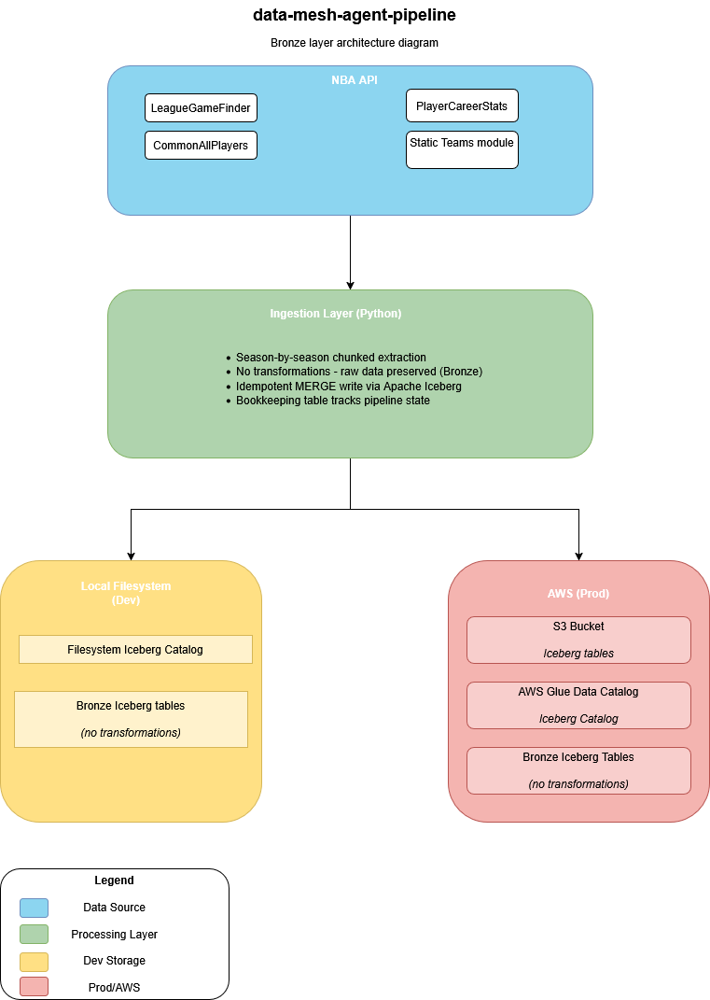
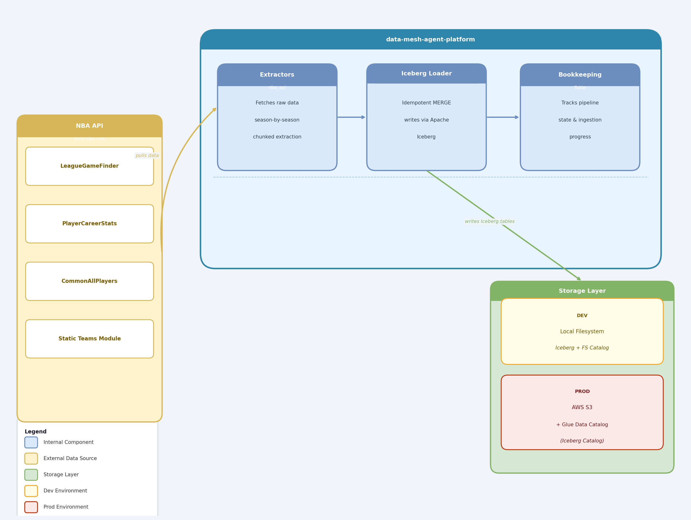

# M1: Ingestion & Storage Layer

> **DataMesh Agent Platform — M1**  
> Pulls raw data from the NBA API and stores it as Apache Iceberg tables 
> in a Bronze lakehouse layer. Supports two environments: local filesystem 
> (dev) and AWS S3 + Glue Data Catalog (prod).

---

## Table of Contents

- [Architecture](#architecture)
- [Bronze Layer Schema](#bronze-layer-schema)
- [Ingestion Design](#ingestion-design)
- [Two-Environment Setup](#two-environment-setup)
- [Environment Setup](#environment-setup)
- [How to Run Locally](#how-to-run-locally)
- [Environment Variables Reference](#environment-variables-reference)

---

## Architecture





---

## Bronze Layer Schema

The Bronze layer stores data **exactly as received from the NBA API**. 
No transformations or business logic are applied at this stage. 
All tables are Apache Iceberg format, providing ACID transactions, 
schema evolution, and time travel out of the box.

### Tables Overview

| Table | Source Endpoint | Primary Key | Partition | Type |
|---|---|---|---|---|
| `bronze_teams` | `nba_api.stats.static.teams` | `TEAM_ID` | None | Dimension |
| `bronze_players` | `CommonAllPlayers` | `PERSON_ID` | None | Dimension |
| `bronze_game_stats` | `LeagueGameFinder` | `GAME_ID + TEAM_ID` | `SEASON_ID` | Fact |
| `bronze_player_stats` | `PlayerCareerStats` | `PLAYER_ID + SEASON_ID` | `SEASON_ID` | Fact |

### bronze_teams

Static reference table for all 30 NBA teams. Sourced from the 
`nba_api` static module — no API call required.

| Column | Type | Nullable | Description |
|---|---|---|---|
| `TEAM_ID` | LONG | No | Unique NBA team identifier — primary key |
| `FULL_NAME` | STRING | No | Full team name (e.g. Los Angeles Lakers) |
| `ABBREVIATION` | STRING | No | Three-letter team code (e.g. LAL) |
| `NICKNAME` | STRING | No | Team nickname (e.g. Lakers) |
| `CITY` | STRING | No | City the team represents |
| `STATE` | STRING | Yes | US state |
| `YEAR_FOUNDED` | INTEGER | Yes | Year the franchise was established |

### bronze_players

All players active across any season in the configured range. 
Sourced via a single `CommonAllPlayers` API call.

| Column | Type | Nullable | Description |
|---|---|---|---|
| `PERSON_ID` | LONG | No | Unique NBA player identifier — primary key |
| `DISPLAY_LAST_COMMA_FIRST` | STRING | No | Player name in Last, First format |
| `DISPLAY_FIRST_LAST` | STRING | Yes | Player name in First Last format |
| `ROSTERSTATUS` | INTEGER | No | Active roster status flag (1 = active) |
| `FROM_YEAR` | STRING | No | First season the player was active |
| `TO_YEAR` | STRING | No | Most recent season the player was active |
| `TEAM_ID` | LONG | Yes | Most recent team identifier |
| `TEAM_ABBREVIATION` | STRING | Yes | Most recent team abbreviation |
| `TEAM_NAME` | STRING | Yes | Most recent team name |
| `GAMES_PLAYED_FLAG` | STRING | Yes | Flag indicating games played |

### bronze_game_stats

One row per team per game. The primary fact table for team-level 
game performance. Partitioned by `SEASON_ID` for efficient 
season-scoped queries.

| Column | Type | Nullable | Description |
|---|---|---|---|
| `GAME_ID` | STRING | No | Unique game identifier — composite key pt.1 |
| `TEAM_ID` | LONG | No | NBA team identifier — composite key pt.2 |
| `SEASON_ID` | STRING | No | Season identifier (e.g. 2024-25) — partition key |
| `TEAM_ABBREVIATION` | STRING | No | Three-letter team code |
| `TEAM_NAME` | STRING | No | Full team name |
| `GAME_DATE` | DATE | No | Date the game was played |
| `MATCHUP` | STRING | No | Matchup string (e.g. LAL vs. BOS) |
| `WL` | STRING | Yes | Result — W (win) or L (loss) |
| `MIN` | INTEGER | Yes | Minutes played |
| `PTS` | INTEGER | Yes | Points scored |
| `FGM` | INTEGER | Yes | Field goals made |
| `FGA` | INTEGER | Yes | Field goals attempted |
| `FG_PCT` | FLOAT | Yes | Field goal percentage |
| `FG3M` | INTEGER | Yes | Three-point field goals made |
| `FG3A` | INTEGER | Yes | Three-point field goals attempted |
| `FG3_PCT` | FLOAT | Yes | Three-point field goal percentage |
| `FTM` | INTEGER | Yes | Free throws made |
| `FTA` | INTEGER | Yes | Free throws attempted |
| `FT_PCT` | FLOAT | Yes | Free throw percentage |
| `OREB` | INTEGER | Yes | Offensive rebounds |
| `DREB` | INTEGER | Yes | Defensive rebounds |
| `REB` | INTEGER | Yes | Total rebounds |
| `AST` | INTEGER | Yes | Assists |
| `STL` | INTEGER | Yes | Steals |
| `BLK` | INTEGER | Yes | Blocks |
| `TOV` | INTEGER | Yes | Turnovers |
| `PF` | INTEGER | Yes | Personal fouls |
| `PLUS_MINUS` | FLOAT | Yes | Plus/minus rating for the game |

### bronze_player_stats

Season-level aggregate statistics per player. One row per player 
per season. Covers player movement across teams — a player traded 
mid-season will have multiple rows for that season (one per team).
Partitioned by `SEASON_ID`.

| Column | Type | Nullable | Description |
|---|---|---|---|
| `PLAYER_ID` | LONG | No | Unique player identifier — composite key pt.1 |
| `SEASON_ID` | STRING | No | Season identifier — composite key pt.2 / partition key |
| `LEAGUE_ID` | STRING | Yes | League identifier |
| `TEAM_ID` | LONG | Yes | Team identifier for that season |
| `TEAM_ABBREVIATION` | STRING | Yes | Team abbreviation for that season |
| `PLAYER_AGE` | FLOAT | Yes | Player age during that season |
| `GP` | INTEGER | Yes | Games played |
| `GS` | INTEGER | Yes | Games started |
| `MIN` | FLOAT | Yes | Average minutes per game |
| `FGM` | FLOAT | Yes | Field goals made per game |
| `FGA` | FLOAT | Yes | Field goals attempted per game |
| `FG_PCT` | FLOAT | Yes | Field goal percentage |
| `FG3M` | FLOAT | Yes | Three-point field goals made per game |
| `FG3A` | FLOAT | Yes | Three-point field goals attempted per game |
| `FG3_PCT` | FLOAT | Yes | Three-point field goal percentage |
| `FTM` | FLOAT | Yes | Free throws made per game |
| `FTA` | FLOAT | Yes | Free throws attempted per game |
| `FT_PCT` | FLOAT | Yes | Free throw percentage |
| `OREB` | FLOAT | Yes | Offensive rebounds per game |
| `DREB` | FLOAT | Yes | Defensive rebounds per game |
| `REB` | FLOAT | Yes | Total rebounds per game |
| `AST` | FLOAT | Yes | Assists per game |
| `STL` | FLOAT | Yes | Steals per game |
| `BLK` | FLOAT | Yes | Blocks per game |
| `TOV` | FLOAT | Yes | Turnovers per game |
| `PF` | FLOAT | Yes | Personal fouls per game |
| `PTS` | FLOAT | Yes | Points per game |

> **Note:** `SEASON_ID` format differs between endpoints in the raw 
> NBA API response (`22024` vs `2024-25`). This inconsistency is 
> preserved in Bronze and normalised in the Silver layer in M2 — 
> see ADR-003 for the reasoning.

---

## Ingestion Design

### Core Principles

**Land raw, transform later**  
Bronze stores exactly what the API returns. No business logic, 
no format corrections, no interpretations. This preserves source 
fidelity and protects against premature data loss.

**Idempotent by design**  
All writes use Iceberg MERGE operations (upserts). Rerunning the 
pipeline for any season produces the same result with no duplicate rows.

**Resumable on failure**  
A dedicated Iceberg bookkeeping table tracks the last successfully 
completed season per entity type. The pipeline resumes from where it 
left off after any failure — no manual intervention required.

### Execution Order

Dimension tables are loaded first since fact tables reference their keys:

```
1. bronze_teams         → static module, single call, no API overhead
2. bronze_players       → single CommonAllPlayers call
3. bronze_game_stats    → LeagueGameFinder, season by season
4. bronze_player_stats  → PlayerCareerStats, season by season
```

### Season Range and Ordering

Seasons are generated programmatically and processed oldest-first:

```python
seasons = [f"{y}-{str(y + 1)[-2:]}" for y in range(2004, 2025)]
# ['2004-05', '2005-06', ..., '2024-25']
```

Oldest-first ordering ensures historical seasons — which are 
immutable — are completed and skipped on subsequent runs. Only 
the current or most recent season requires re-checking.

### Write Pattern

```
For each season:
    1. Check bookkeeping table — skip if status = complete
    2. Extract data from NBA API endpoint
    3. Write to Iceberg table via MERGE (upsert on primary key)
    4. Commit transaction atomically
    5. Update bookkeeping table — status = complete
    6. Move to next season
```

If the pipeline fails between steps 4 and 5, the season is safely 
re-processed on the next run — the MERGE operation ensures no duplicates.

### Bookkeeping Table Schema

```
season_id | entity_type        | status      | rows_loaded | loaded_at
----------|--------------------|-------------|-------------|------------
2004-05   | bronze_game_stats  | complete    | 24832       | 2024-01-15
2005-06   | bronze_game_stats  | complete    | 26441       | 2024-01-15
2006-07   | bronze_game_stats  | in_progress | 0           | 2024-01-15
```

### NBA API Constraints

The NBA stats endpoint (`stats.nba.com`) is a public web endpoint, 
not a purpose-built API. Two constraints to handle in the ingestion layer:

- **Response latency**: 5-10 seconds per call — pipeline uses a 1-second 
  delay between requests and a 30-second timeout
- **No authentication**: No API keys required, but requests must include 
  browser-like headers (handled by `nba_api` by default)

---

## Two-Environment Setup

| | Local Dev | Production |
|---|---|---|
| **Catalog** | Filesystem Iceberg catalog | AWS Glue Data Catalog |
| **Storage** | Local filesystem | AWS S3 |
| **Setup cost** | Zero | ~$1-3/month |
| **Use case** | Pipeline development and iteration | Validated runs, portfolio deployment |

Catalog connection details are externalised as environment variables. 
Pipeline code is identical across both environments — only the catalog 
backend differs.

---

## Environment Setup

### Prerequisites

- Python 3.9+
- AWS account with S3 and Glue access (prod only)

### Installation

```bash
git clone https://github.com/your-org/datamesh-agent-platform.git
cd datamesh-agent-platform
python -m venv .venv
source .venv/bin/activate        # macOS/Linux
.venv\Scripts\activate           # Windows
pip install -r requirements.txt
```

### Configuration

```bash
cp .env.example .env
```

**Dev — local filesystem:**
```env
ENV=dev
LOCAL_BRONZE_PATH=./data/bronze
LOCAL_CATALOG_PATH=./catalog
```

**Prod — AWS:**
```env
ENV=prod
AWS_BRONZE_BUCKET=your-nba-bronze-bucket
AWS_GLUE_DATABASE=nba_bronze
AWS_REGION=us-east-1
AWS_ACCESS_KEY_ID=your-key
AWS_SECRET_ACCESS_KEY=your-secret
```

### AWS Setup Checklist

Before running in prod, complete the following:

- [ ] Create an S3 bucket for Bronze layer storage
- [ ] Create an IAM user — do not use the root account
- [ ] Attach minimum permissions: `AmazonS3FullAccess`, `AWSGlueConsoleFullAccess`
- [ ] Set a billing alert at $10/month
- [ ] Add AWS credentials to `.env`

> Estimated monthly cost at dev scale: **$1-3/month**

---

## How to Run Locally

```bash
python pipeline.py
```

The pipeline will:
1. Check the bookkeeping table for the last completed season per entity
2. Resume ingestion from where it left off
3. Write each completed season atomically to the appropriate Iceberg table
4. Update the bookkeeping table after each successful season write

**Verify output — query a Bronze table locally:**

```python
from pyiceberg.catalog import load_catalog

catalog = load_catalog(
    "local",
    **{"type": "filesystem", "warehouse": "./catalog"}
)
table = catalog.load_table("bronze.game_stats")
df = table.scan().to_pandas()
print(df.head())
```

---

## Environment Variables Reference

| Variable | Environment | Required | Description | Example |
|---|---|---|---|---|
| `ENV` | Both | Yes | Deployment target | `dev` or `prod` |
| `LOCAL_BRONZE_PATH` | Dev | Yes | Local Iceberg warehouse path | `./data/bronze` |
| `LOCAL_CATALOG_PATH` | Dev | Yes | Local filesystem catalog path | `./catalog` |
| `AWS_BRONZE_BUCKET` | Prod | Yes | S3 bucket for Bronze layer | `nba-bronze-bucket` |
| `AWS_GLUE_DATABASE` | Prod | Yes | Glue catalog database name | `nba_bronze` |
| `AWS_REGION` | Prod | Yes | AWS region | `us-east-1` |
| `AWS_ACCESS_KEY_ID` | Prod | Yes | IAM user access key | — |
| `AWS_SECRET_ACCESS_KEY` | Prod | Yes | IAM user secret key | — |
